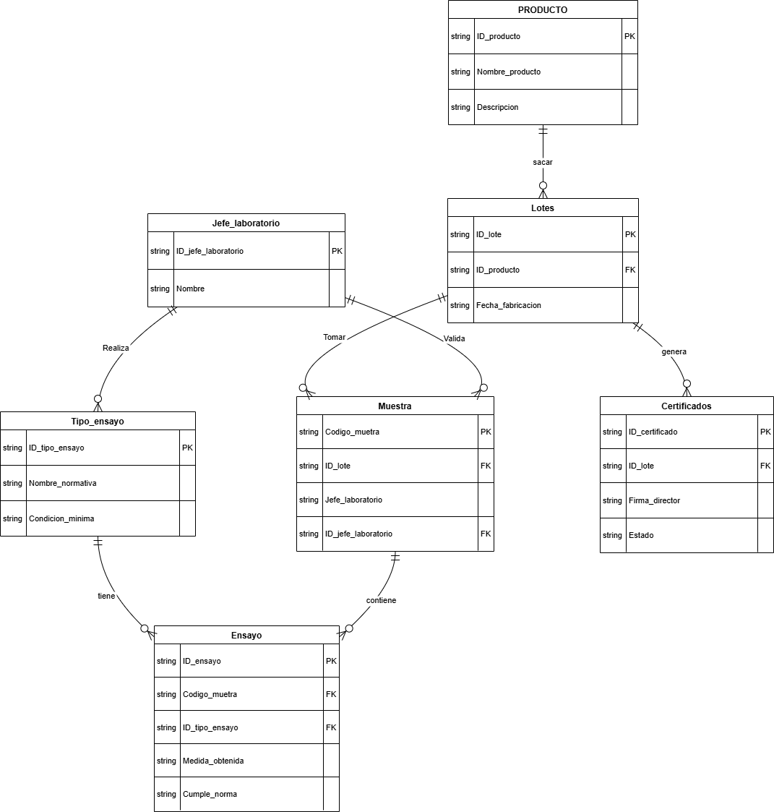

# Laboratorio DML – Unidad 3 – Bases de datos

| | |
|---|---|
| **Universidad** | Universidad de Cartagena |
| **Programa** | Ingeniería de Software |
| **Asignatura** | Bases de datos – Unidad 3 |
| **Actividad** | Laboratorio práctico: dominio de sentencias DML (INSERT, UPDATE, DELETE) en entornos multimotor |
| **Estudiante** | Moises Banda Perez |
| **Docente** | John Carlos Arrieta Arrieta |

## Descripción

Práctica de las sentencias `INSERT`, `UPDATE` y `DELETE` sobre el modelo relacional de un laboratorio de
control de calidad (productos, lotes, muestras, ensayos y certificados), con tres motores de bases de datos:

| Motor | Versión | Clientes |
|---|---|---|
| MySQL | 9.7 | MySQL Workbench |
| PostgreSQL | 18.6 | pgAdmin 4 y psql |
| Oracle Database | 21c XE | Oracle SQL Developer |

## Modelo relacional



## Tablas utilizadas en la segunda parte

| Rol | Tabla | Descripción |
|---|---|---|
| TablaX | `lotes` | Tabla padre. Se agregaron `cantidad` y `observaciones` para trabajar con columnas numéricas y de texto |
| TablaZ | `muestra` | Tabla hija, con llave foránea `id_lote` hacia `lotes` |
| TablaY | `tablay` | Tabla de notas del punto 58 |

## Estructura del repositorio

```
backup/        Respaldos (.sql) y archivos .bat para respaldar y restaurar
modelo/        Modelo relacional
mysql/         Scripts para MySQL
postgresql/    Scripts para PostgreSQL
oracle/        Scripts para Oracle
docs/capturas/ Capturas de pantalla
```

Cada carpeta de motor contiene los mismos archivos:

| Archivo | Contenido |
|---|---|
| `00_usuario.sql` | Creación de `usuario_5` |
| `01_estructura.sql` | Creación de las 7 tablas |
| `02_datos_base.sql` | Jefes de laboratorio, productos y tipos de ensayo |
| `03_insert_y_errores_p01-31.sql` | Puntos 1 a 31 |
| `04_update_p32-57.sql` | Puntos 32 a 57 |
| `05_tablay_p58-65.sql` | Puntos 58 a 65 |
| `06_delete_p66-69.sql` | Puntos 66 a 69 |
| `07_verificacion.sql` | Consultas de verificación (tablas, conteos y bases visibles) |

Las sentencias de los puntos 1 a 69 se ejecutan una por una, porque varias fallan a propósito
(llaves foráneas, NOT NULL, tipos de datos y fechas inválidas).

## Restauración de los respaldos

**MySQL:** en Workbench, *Server > Data Import > Import from Self-Contained File* con
`backup/backup_mysql_bd_laboratorio.sql`, o ejecutar `backup/restaurar_mysql.bat`.

**PostgreSQL:** con una base vacía `bd_laboratorio`, desde la carpeta del repositorio:

```bat
set PGCLIENTENCODING=UTF8
"C:\Program Files\PostgreSQL\18\bin\psql.exe" -U postgres -d bd_laboratorio -f "backup\backup_pg_bd_laboratorio.sql"
```

El respaldo contiene comandos de `psql` y datos en bloques `COPY`, por lo que no se ejecuta desde la
*Query Tool* de pgAdmin. También sirve `backup/restaurar_postgresql.bat`.

**Oracle:** en SQL Developer, conectado como `usuario_5` (servicio `XEPDB1`), abrir
`backup/backup_oracle_bd_laboratorio.sql` y ejecutarlo con *Run Script*.

> Las contraseñas no se publican en este repositorio.
